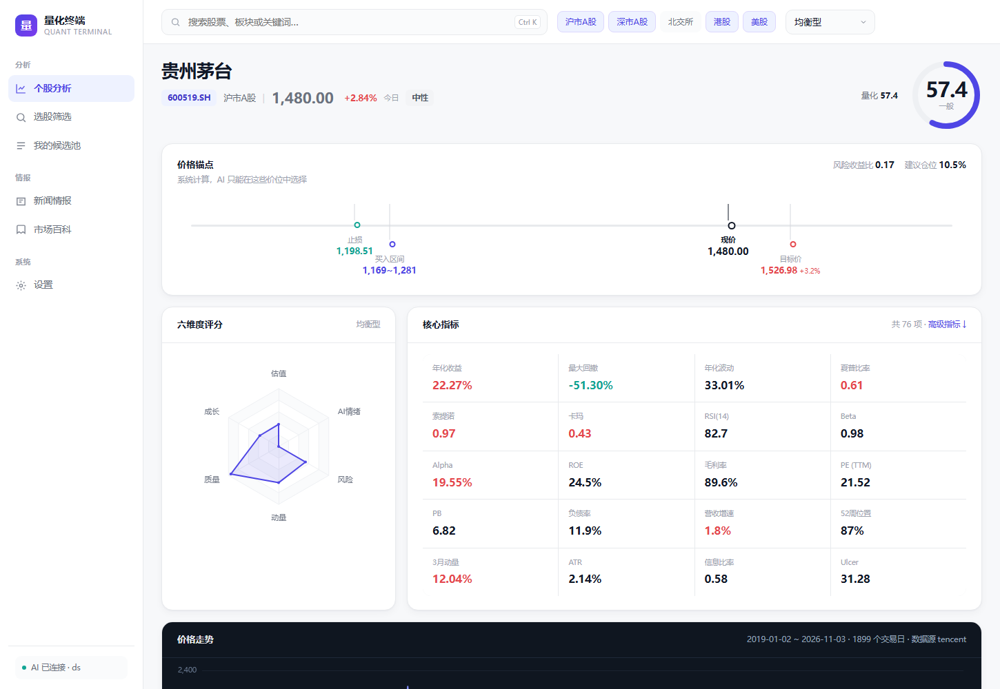
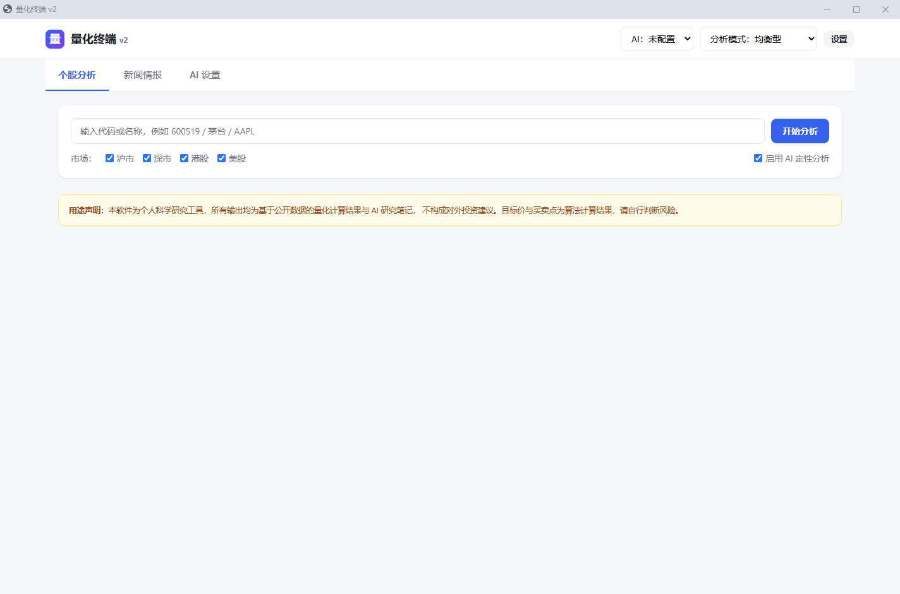

# 量镜 QuantLens

> 一个跑在自己电脑上的 AI 量化分析工具。
> 打开是**市场全景热力图**，输入股票代码则输出 **76 项量化指标 + 六维度评分 + 目标价/买入区间/止损位 + 走势推演 + 配仓建议 + AI 定性分析**。

Windows 桌面应用，双击即用，无需服务器、无需注册、数据全部留在本地。

> ⚠️ **重要声明**：本项目是个人科学研究工具，**不构成任何投资建议**。
> 所有输出的目标价、买入区间、止损位、仓位建议、走势推演区间，都是算法计算结果，
> 不是买卖指令。走势推演是基于历史数据的蒙特卡洛模拟，**不是价格预测**。
> 据此操作的风险由使用者自行承担。



---

## 特性

### 量化分析
- **76 项指标**，分三层展示（核心 → 高级 → 原始数据）
  - 收益风险：年化收益、波动率、最大回撤、回撤持续期、VaR/CVaR、偏度峰度、Ulcer 疼痛指数
  - 风险调整：夏普、索提诺、卡玛、Omega
  - 相对基准：Beta、Alpha、跟踪误差、信息比率、特雷诺、上下行捕获率
  - 动量技术：1/3/6/12 月动量、RSI、MACD、KDJ、布林带、ADX、OBV、CCI、Williams %R
  - 统计特征：Hurst 指数、方差比、均值回归半衰期、自相关、JB 正态性检验
  - 基本面：PE/PB/股息率/PEG、ROE/ROIC、毛利率净利率、负债率、现金流质量
- **8 套分析模式**：均衡 / 价值 / 成长 / 质量 / 动量 / 低波 / 红利 / 困境反转
  - 像选模型一样选权重，切换后全站评分实时重算
  - 缺数据时权重自动重新归一化（美股没财务数据也公平可比）

### 价格锚点（不给目标价拍脑袋）
| 价位 | 算法 |
|---|---|
| 目标价 | 技术阻力位（近3月/1年/2年高点）+ 估值回归法（PE 回到 15/20/25/30 倍） |
| 买入区间 | 支撑位（MA20/60/120、近60日低、近250日低） |
| 止损位 | `min(现价 - 2×ATR, 近60日低 × 0.97)` |
| 建议仓位 | 风险预算法（单笔最大亏损 2%） |

### AI 定性分析
- 支持**任意 OpenAI 兼容接口**：DeepSeek / Kimi / 通义 / 智谱 / OpenAI / OpenRouter / 本地 Ollama / 自建中转站
- 同时支持 **Anthropic 原生协议**
- 自动探测渠道能力（流式 / JSON 模式 / system 角色）
- JSON 输出三级降级（JSON模式 → 剥代码块 → 语法修复），适配不听话的中转站
- 多渠道路由：一个挂了自动切下一个
- **密钥用 Windows DPAPI 加密**，换台电脑解不开

### 新闻情报
- 4 源聚合：东方财富 / 华尔街见闻 / 新浪财经 / Google News
- 相似标题去重 + 相关性排序 + 6 小时缓存
- AI 归纳成：关键事件 / 影响板块 / 情绪倾向 / 相关个股
- 内置 30 个 A 股板块映射表（关键词 → 板块 → 代表个股）

### 选股筛选
- 91 只候选池（30 个板块代表个股），也可用自建候选池
- 6 个条件组合筛选（PE / ROE / 市值 / 动量 / 回撤 / 综合分）
- 8 线程并发，91 只约 13 秒

### 自定义候选池 🆕
- **多个池**：自建「核心持仓」「白酒观察」，各自独立
- **批量添加**：粘贴一串代码（混着中文名也行）、按板块整组导入、从筛选结果导入
- **按行业分组**：自动按板块归类展示
- **批量操作**：全选、批量移除、批量量化分析
- 内置「预置·全部板块」池（91 只，不可删）

### 搜索联想 🆕
输入时下拉分组显示：**板块 → 个股 → 最近搜索**，本地先出结果、联网结果后合并。
支持 ↑↓ 选择、回车确认、Ctrl+K 聚焦。

### 市场百科（知识库）🆕
32 条中国金融市场规则，每条强制带一栏 **「对量化分析的影响」**：

| 规则 | 对分析的影响 |
|---|---|
| T+1 | 回测不能当日买当日卖，否则高估收益 |
| 涨跌停 | 涨停买不进、跌停卖不出，必须模拟 |
| 除权除息 | 不复权会算出虚假暴跌 |
| 交易费用 | 高频策略会被 0.11% 往返成本吃光 |

支持中文 / 英文 / 中英对照三种显示（设置里切换）。

### 概念库（行业 + 概念，可自定义）🆕
- **双层结构**：行业 22 个（稳定的产业分类）+ 概念 27 个（跨行业主题），覆盖 136 只股票
- **用户可自建**：新建概念、加成分股、加别名、改名、改类型
- **别名参与新闻匹配**：「算力租赁」能命中「AI算力」概念
- 新概念自动进入搜索联想

### 市场全景热力图 🆕（首屏）
Finviz 风格的树状图：**面积 = 市值，颜色 = 涨跌幅**，按行业分组。

- 覆盖沪深 + 港股 + 美股共 144 只标的、30 个行业
- **按市值 / 等权** 两种口径切换（美股巨头占 37% 市值，等权模式才看得清 A 股中小盘）
- 每日快照落库，「今天的封面」一整天不变，可一键导出 PNG
- 点击板块放大、点击个股直接跳分析页

### 我的持仓（持仓日志）🆕
像记账一样记录每次买入，自动算市值、浮盈和配比。

- **一次买入 = 一条记录**，同一只股票分批建仓分开记，不丢买入时间
- 加权均价、持股天数、浮动盈亏、占总仓比例全部自动算
- **目标配比 vs 实际占比**：配比图上画灰色虚线，自动标出「超配 6%」或「低配 13%」
- 取不到当前价的记录会标「估」字，不拿买入价冒充现价

### 时序模型对比 🆕
五个模型（随机游走 / 带漂移 / Holt 阻尼 / OLS 趋势 / AR(5)）各跑一遍，
用 **5 个检验窗口的样本外误差**比出谁更好，然后**如实告诉用户**。

- **和随机游走做基准对比** —— 跑不赢基准就直接说「没有模型显著优于随机游走」
- 只有真的跑赢的模型路径才会画到图上（黄色虚线），不赢就不画
- 实测一半的股票上（比亚迪、宁德时代），没有任何模型能赢过随机游走 —— 界面如实显示
- 所有模型预测的累计涨跌幅夹在 ±40% 内（直线外推会推出脱离现实的价格）

### 走势推演 🆕
蒙特卡洛自举模拟，画出未来 20 个交易日的 **5%/25%/50%/75%/95% 分位带**。

- **块自举**（5 天一块）而不是正态假设 —— 保留厚尾和短期相关性
- **GARCH(1,1) 波动率校正** —— 高波动期区间自动变宽
- **区间按区间显示**：一条比例尺上并排画 90% 区间和 50% 区间，中位线标出，
  而不是给三个孤立的目标价
- 输出上涨概率、触及目标/止损概率、**先到目标还是先到止损**的路径统计
- **校准检验**：用历史走查回测，验证 50%/90% 区间到底罩不罩得住真实价

实测茅台：90% 区间命中率 92%（预期 90%，校准良好），
50% 区间命中率 67%（预期 50%，偏保守 —— 宁可画宽，不是过度自信）。

### 配仓建议 🆕
规则引擎驱动，**每条结论都附依据数字**，可逐条核对（不交给 AI 编）。

| 现价位置 | 动作 |
|---|---|
| 跌破止损 | 止损离场 |
| 买入区间内 | 分批建仓 |
| 略高于上沿 | 回踩加仓 |
| 明显高于上沿 | 等待回落 |
| 接近目标价 | 到目标价·减仓 |

仓位 = 基础仓位 × 评分因子 × 波动因子 × 超买因子 × 模拟因子，最终 clamp 到 [3%, 25%]。
输出三档分批计划（40%/35%/25%）和三类触发条件。

### 多市场
| 市场 | 行情 | 估值 | 财务 |
|---|---|---|---|
| 沪市 / 深市 / 北交所 | ✅ | ✅ | ✅ 完整 |
| 港股 | ✅ | ✅ | ⚠️ 仅 PE/PB |
| 美股 | ✅ | ✅ | ⚠️ 仅 PB/市值 |

数据源：腾讯财经（A股/港股主通道）、Yahoo Finance（美股主通道）、东方财富（估值/财务/搜索）。
**全部免费公开接口，无需申请 key。**

---

## 快速开始

### 1. 安装 Python（如果还没装）

去 [python.org](https://www.python.org/downloads/) 下载 **Python 3.10 或更高版本**。

> ⚠️ 安装时**务必勾选 `Add Python to PATH`**，否则后面找不到。

### 2. 一键安装依赖

双击项目里的 **`install.bat`**，等待 3-8 分钟（首次要下载约 250MB）。

### 3. 启动

双击 **`启动.vbs`**（或 `Launch.vbs`）。

大约 2 秒后，会弹出一个独立窗口：



**没有黑窗口，没有浏览器地址栏，就是一个软件。**

---

## 配置 AI（可选）

不配 AI 也能用——所有量化指标、评分、价格锚点都是程序算的，不依赖 AI。

配了 AI 之后额外得到：多空理由、催化剂、风险点、综合定性评分。

1. 打开「AI 设置」标签页
2. 选预设（或"自定义中转站"）
3. 填 `base_url`、`模型名`、`API Key`
4. 点「探测」测试能力
5. 保存

> 💡 用中转站常见问题见 [docs/15-AI连接失败排查.md](docs/15-AI连接失败排查.md)

---

## 项目结构

```
quant-terminal/
├── 启动.vbs              ← 双击这个启动
├── install.bat           ← 首次运行装依赖
├── desktop_qt.py         ← 桌面入口（PyQt6 独立窗口）
├── serve.py              ← 只启动服务（调试用）
├── requirements.txt
│
├── app/
│   ├── markets/          多市场数据适配器
│   │   ├── symbols.py    统一代码体系（600519.SH / AAPL.US）
│   │   ├── tencent.py    腾讯行情
│   │   ├── yahoo.py      Yahoo 行情
│   │   ├── eastmoney.py  东财估值/财务/搜索
│   │   └── registry.py   自动降级调度
│   ├── analytics/        指标引擎
│   │   ├── price.py      30 项价格指标
│   │   ├── fundamental.py 18 项基本面指标
│   │   ├── extended.py   28 项扩展指标
│   │   ├── scoring.py    6 维度评分 + 8 套模式
│   │   └── anchors.py    价格锚点（目标价/止损/仓位）
│   ├── ai/               AI 网关
│   │   ├── gateway.py    双协议 + 能力探测 + 失败重试
│   │   ├── channels.py   渠道管理 + 用量统计
│   │   ├── secret_store.py  DPAPI 密钥加密
│   │   ├── json_utils.py JSON 三级降级解析
│   │   └── prompts.py    Prompt 模板
│   ├── news/             新闻引擎
│   ├── analysis/         分析编排 + 防幻觉校验
│   ├── api/              REST 接口
│   └── core/             配置/数据库/心跳
│
├── static/               前端页面（原生 HTML + ECharts）
├── tests/                59 个单元测试
├── tools/                数据源探测 / 验收脚本 / 模拟 AI 服务器
└── docs/                 完整文档（14 篇）
```

---

## 技术栈

| 层 | 选择 | 为什么 |
|---|---|---|
| 计算 | Python + pandas/numpy | 金融分析生态无可替代 |
| 后端 | FastAPI + uvicorn | 自动生成接口文档，性能好 |
| 界面 | 原生 HTML + ECharts | 零构建，图表能力最强 |
| 桌面 | PyQt6 + QtWebEngine | 内嵌 Chromium，不依赖系统浏览器 |
| 存储 | SQLite | 单文件，零配置 |
| 密钥 | Windows DPAPI | 系统级加密，不用装第三方库 |

**为什么是"本地服务 + 内嵌浏览器"而不是原生 GUI？**
量化计算必须用 Python（pandas/numpy），而 Python 做复杂图表界面的最佳方案是网页技术。
用 QtWebEngine 把网页嵌进程序，既有 Python 的计算能力，又有网页的界面表现力，
同时是一个真正的独立窗口——不是浏览器标签页。

---

## 开发

```bash
# 装开发依赖后
python serve.py 8765        # 只启动服务，浏览器打开 http://127.0.0.1:8765
python desktop_qt.py        # 独立窗口模式（开发时调试用这个）

# 跑测试
python -m unittest discover -s tests -v
# 期望：Ran 59 tests ... OK
```

---

## 文档

完整目录见 **[docs/README.md](docs/README.md)**。最常看的几篇：

| 文档 | 内容 |
|---|---|
| [01-环境搭建](docs/01-环境搭建.md) | 装 Python、装依赖、验证 |
| [05-运行手册](docs/05-运行手册.md) | 三种跑法、日志怎么读、跑测试、打包 |
| [14-启动方式说明](docs/14-启动方式说明.md) | 启动方式与常见问题 |
| [18-概念库与走势推演](docs/18-概念库与走势推演.md) | GARCH、蒙特卡洛、校准检验、配仓建议 |
| [15-AI连接失败排查](docs/15-AI连接失败排查.md) | 中转站连不上时的三步自查 |

开发过程的历史记录在 [docs/history/](docs/history/)，内容已过时，只作存档。

---

## 常见问题

**Q: 双击 `启动.vbs` 没反应？**
先双击 `install.bat` 装依赖。还不行的，用命令行跑 `python desktop_qt.py`，会打印具体错误。

**Q: 提示找不到 Python？**
装 Python 时没勾 `Add Python to PATH`。重装一次并勾上。

**Q: 窗口打开了但一片空白？**
按 `Ctrl+R` 刷新。如果持续空白，看同目录的 `运行日志.log`。

**Q: AI 分析很慢（50 秒左右）？**
中转站要排队 + 生成 400 多字分析，属正常。只想看量化结果的话，把「启用 AI 定性分析」的勾去掉，2-3 秒出结果。

**Q: 数据抓不到？**
检查网络。如果你开着代理软件（TUN 模式会把域名解析成 198.18.x.x 假 IP），可能影响部分数据源。

---

## 免责声明

本软件为**个人科学研究工具**。

- 所有输出均为基于公开数据的量化计算结果与 AI 生成的研究笔记，**不构成任何投资建议**
- 目标价、买入区间、止损位均为算法计算结果，**不构成买卖指令**
- 数据来源于公开接口，仅供学习研究使用，**商业使用需自行获取数据授权**
- 使用本软件产生的任何投资决策与后果，由使用者自行承担

---

## License

[AGPL-3.0](LICENSE)

这意味着：你可以自由使用、修改、分发本软件，但**如果你修改后把它作为网络服务提供给别人用，
你必须公开修改后的源代码**。这是为了防止有人拿它做闭源的收费服务。

如果你需要不同的授权（例如商业闭源使用），请联系作者。
